# BESS WorkBench

Design aid for engineers laying out lithium-ion BESS / ESS (UPS battery) rooms in US hyperscale data centers.

**Design aid. Verify values against adopted codes and AHJ.**

The rules engine is the only source of pass/fail numbers. Optional Claude features draft text and propose edits. They do not override a calculation. The app runs fully offline when no API key is set; AI controls show that they are off.

Sprinklers are wet, dry, or double-interlock preaction. Clean agent, foam, water mist, and single-interlock are out of scope. United States only.

## Run from source

Python 3.12.

```bash
pip install -e ".[dev]"
python -m bess_workbench
```

That works on Linux and on Windows. Open the synthetic sample from **File → Open sample**, or:

```bash
python -m bess_workbench --sample
```

Headless export (no window):

```bash
python -m bess_workbench --export "samples/Sample - 4 Room UPS BESS.bessproj" /tmp/bess-out
```

Tests:

```bash
pytest
```

Screenshots in this README were taken with `QT_QPA_PLATFORM=offscreen python scripts/capture_screenshots.py`.

## Install on Windows

The GitHub Actions workflow on `windows-latest` runs pytest, then publishes two artifacts:

- `BESS-WorkBench.exe` — PyInstaller one-file build
- `BESS-WorkBench-Setup.exe` — Inno Setup installer

A tag named `v*` also attaches those files to a GitHub release. Run the setup executable, or run `BESS-WorkBench.exe` directly. The installer adds a Start menu and desktop shortcut.

To build locally on Windows, from the repo root:

```bash
python -m pip install -e ".[dev]"
python -m PyInstaller packaging/bess_workbench.spec --noconfirm
ISCC.exe packaging\installer.iss
```

## What you can do

Left navigation, a status badge per screen, and a results panel. Autosave, recent files, light theme with an optional dark theme.

1. Project and code basis (IFC/IBC/IMC 2024, NEC 2023, NFPA 855-2023, 72-2022, 13-2025, 69-2024, plus AHJ notes).
2. Rooms and ESS inventory.
3. Thresholds and fire areas, including the 600 kWh rollup and the 5% warning band.
4. Explosion control and exhaust, including the UL 9540A release helper and the IMC 509 / motorized damper checklist.
5. Gas detection and controls, including the points list and the FACP monitor-module shortfall.
6. Cause and effect, editable, with XLSX export.
7. Sprinklers: density × area, +30% for dry and double-interlock with the delta shown, C=100, hose, duct `q = K * sqrt(p)` at 7 psi minimum. Sign-off is blocked when a group over 50 kWh has no UL 9540A report.
8. FACP battery (24 h + 5 min, or 15 min for voice) and gas-panel battery (24 h + 2 h), with 20% margin, aging and temperature derates, and the next standard size.
9. Open items / RFI register.
10. Basis of Design DOCX, workbook XLSX, and summary PDF. Arial in the Word file. Plain professional formatting.

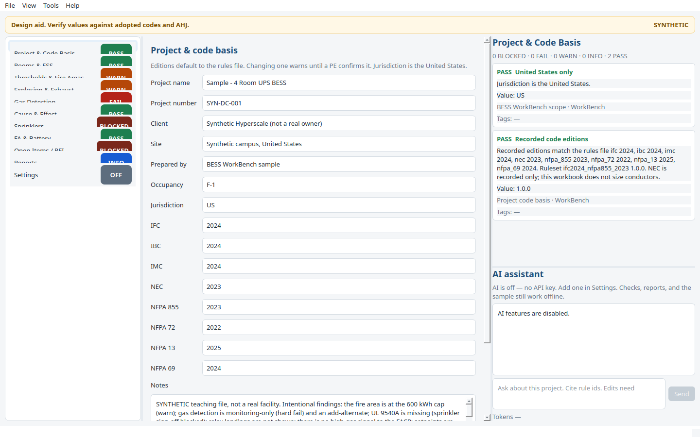

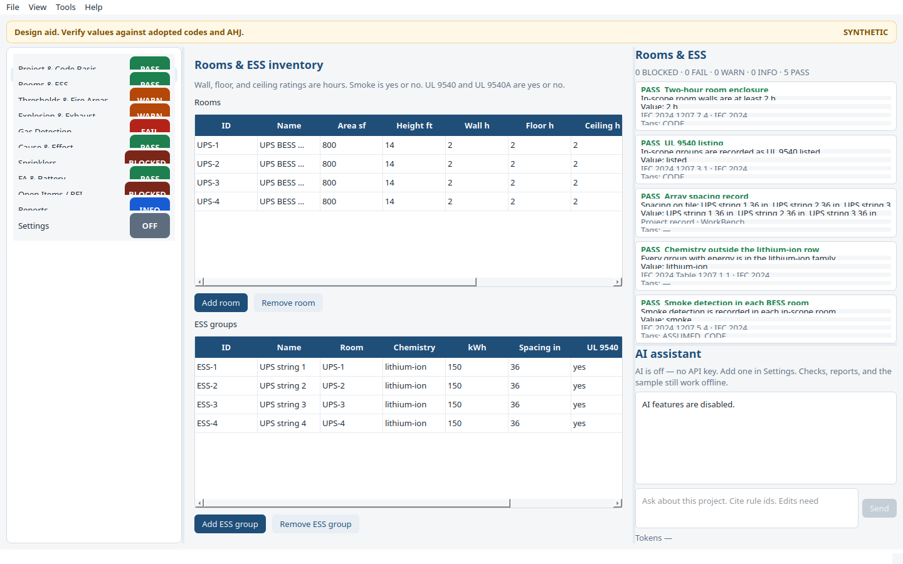

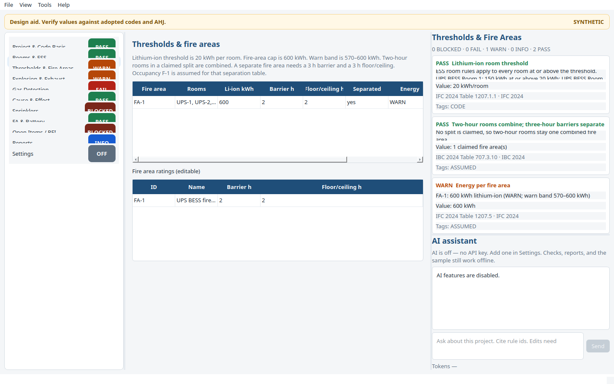

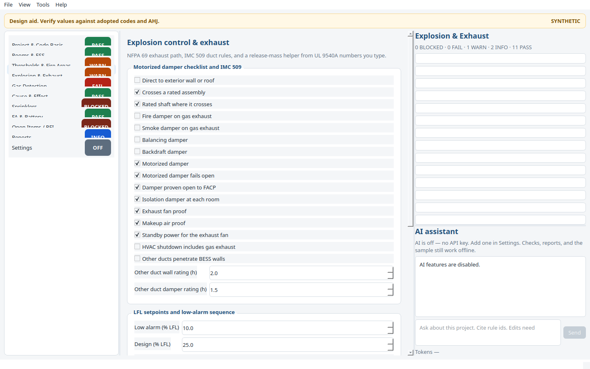

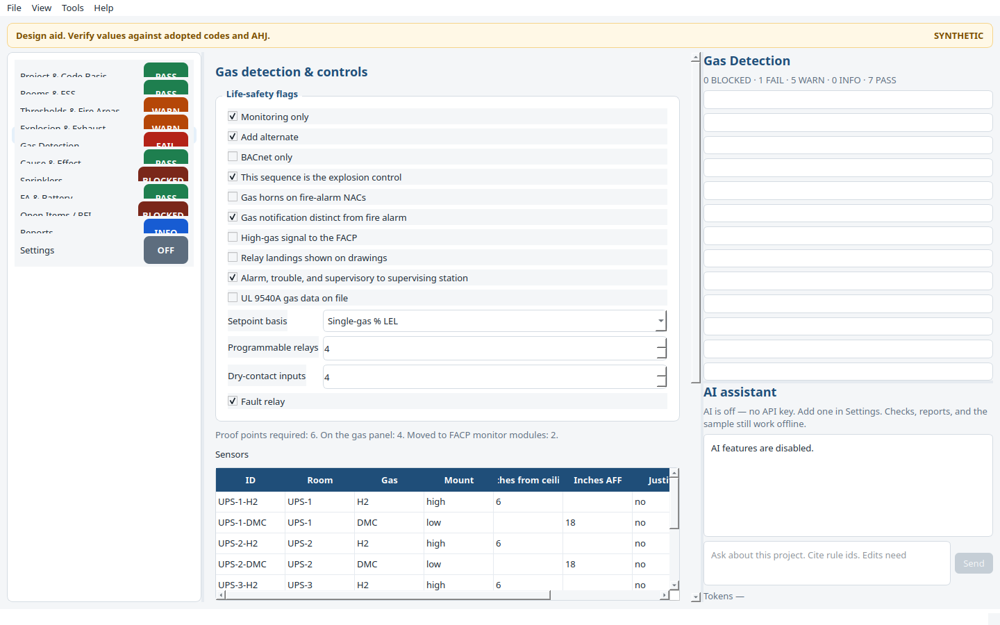

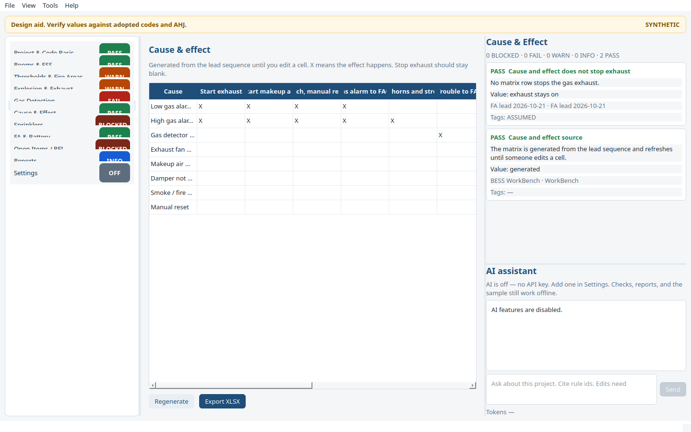

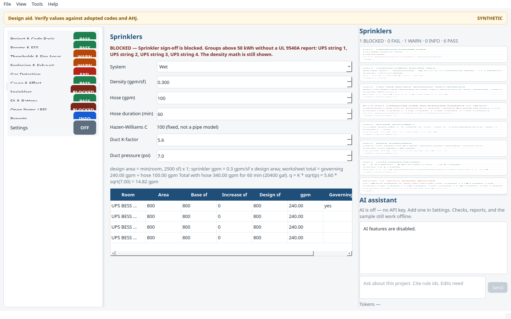

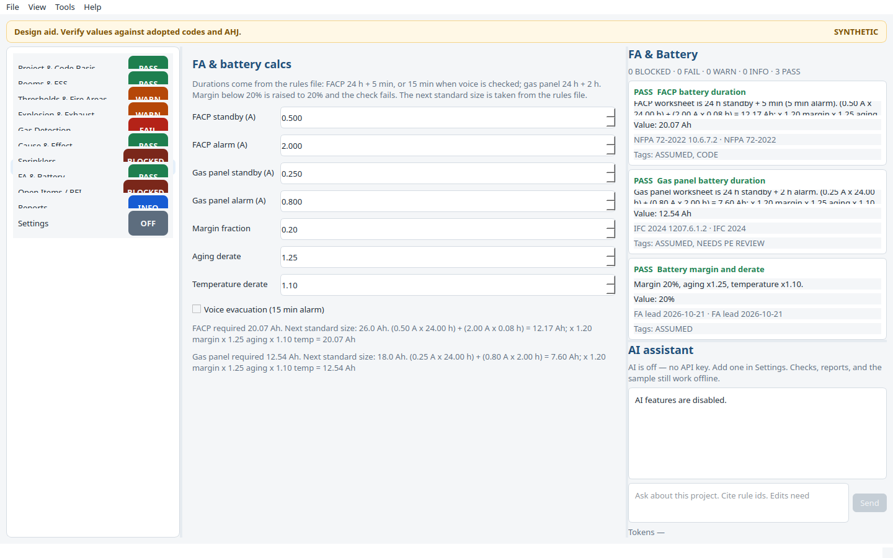

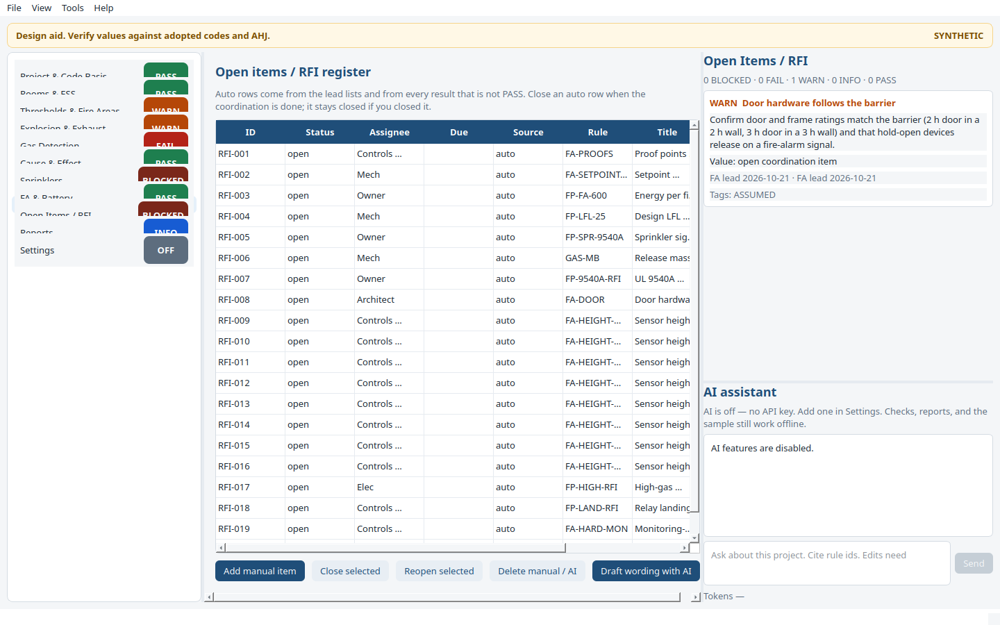

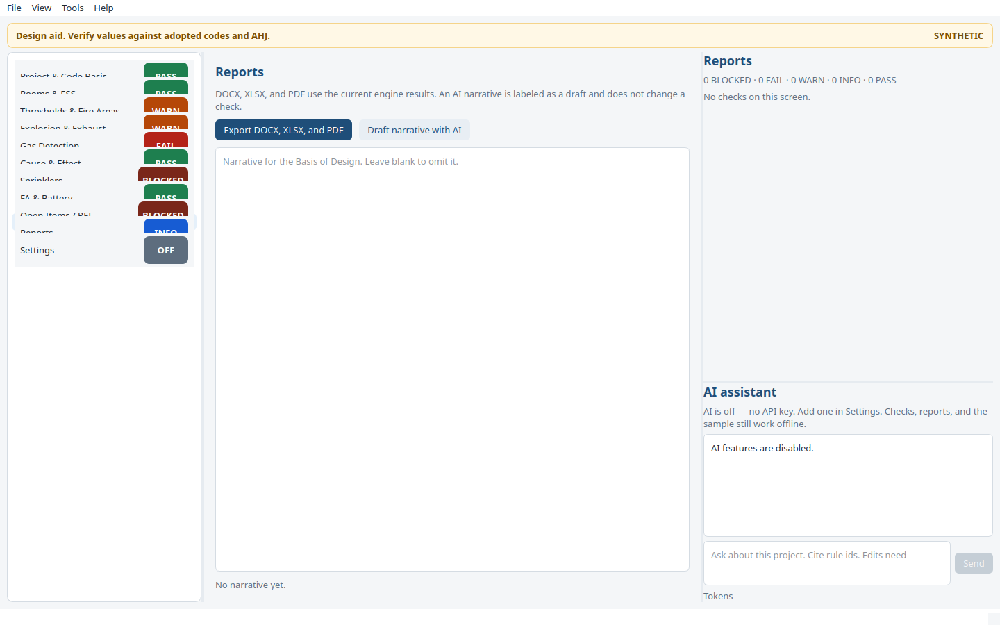

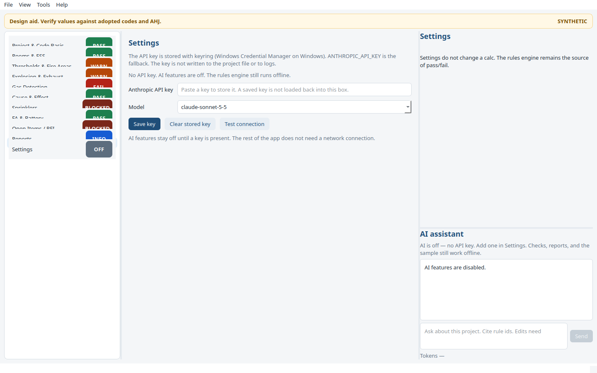

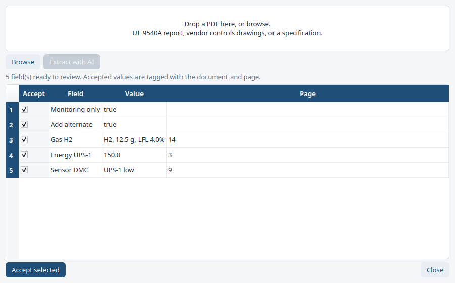

Dark theme is under **View → Dark theme**.

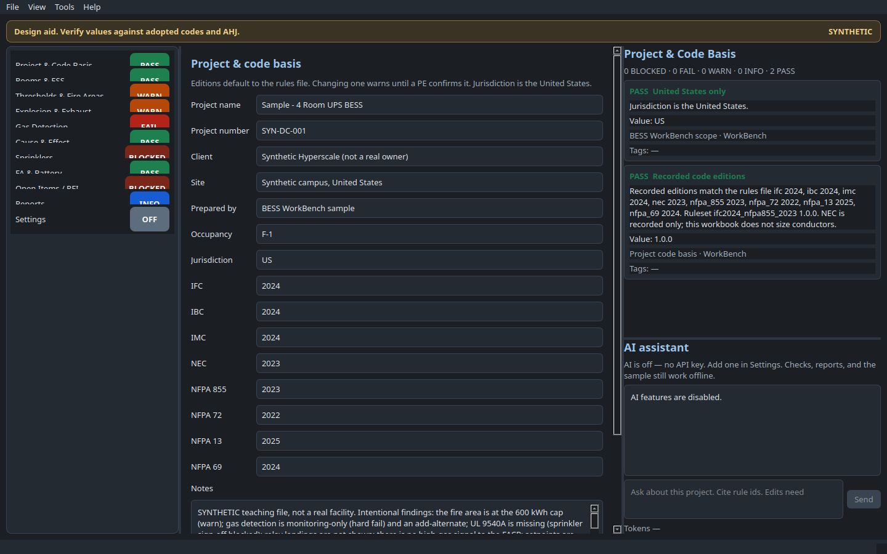

## Sample

`samples/Sample - 4 Room UPS BESS.bessproj` is synthetic. It is not a real facility.

Four lithium-ion UPS rooms at 150 kWh sit in one 2 hour fire area, so the area is at the 600 kWh cap and warns. They share an exhaust. The gas controller has 4 relays, a fault relay, and 4 inputs; six proof points means two move to FACP monitor modules. Each room has H2 and DMC. Sprinklers are wet. Gas detection is marked monitoring-only (and an add-alternate), so the hard fail and the automatic RFIs show. UL 9540A is not on file, so sprinkler sign-off is blocked.

Exports generated from that file are in `docs/sample-exports/`.

## AI

**Settings** stores an Anthropic API key with keyring (Windows Credential Manager on Windows). If keyring has no key, the app uses `ANTHROPIC_API_KEY`. The model defaults to `claude-sonnet-5-5` and the id is editable. **Test connection** sends a one-word ping.

The side panel answers questions with the project JSON and the check results in context, and it can call read-only tools (`get_project`, `run_checks`, `get_rule`, `list_open_items`). `add_rfi` and `set_input` open a diff dialog and do nothing until you approve. Document intake sends a PDF and returns a review table; accepted values keep the file name and page. RFI wording and the Basis of Design narrative are drafts. The DOCX labels the narrative AI-drafted.

The system prompt and the rules file are prompt-cached. Token use and an estimated cost are shown. The key is scrubbed from logs. See `bess_workbench/ai/`.

## Rules file

Edit `rules/ifc2024_nfpa855_2023.json` to change a number, a citation, or a one-line paraphrase. Do not paste standard text into that file. How the tags and the version field work is in [docs/RULES.md](docs/RULES.md). The full check list, data model, and roadmap are in [docs/SPEC.md](docs/SPEC.md).

## Limitations

- This is a design aid. Several lead items are tagged `ASSUMED` or `NEEDS PE REVIEW`, including the 600 kWh cap, the dry-system area increase, the 10% / 25% LFL setpoints (the two leads do not agree at exactly 25%), and the gas-panel 24 h + 2 h battery. Confirm them against the adopted code.
- UL 9540 listing cites IFC 2024 1207.3.1. Confirm that section in the edition you are on.
- There is no pipe-by-pipe hydraulic model. C=100 is recorded only. The release helper is an ideal-gas worksheet, not a dispersion model.
- Battery ampere-hours are only as good as the currents you type. The duration and the 20% margin come from the rules file.
- Spacing is stored and is not checked against a numeric limit. The leads did not give one.
- Only the lithium-ion threshold row is encoded.
- AI output can be wrong. It cannot change a check status, and an edit is applied only after you approve it. Cost figures are estimates.
- Linux PDF output uses Liberation Sans when Arial is not installed. The DOCX still asks for Arial, which Word on Windows will use.
- The sample project and the intake screenshot data are synthetic.
